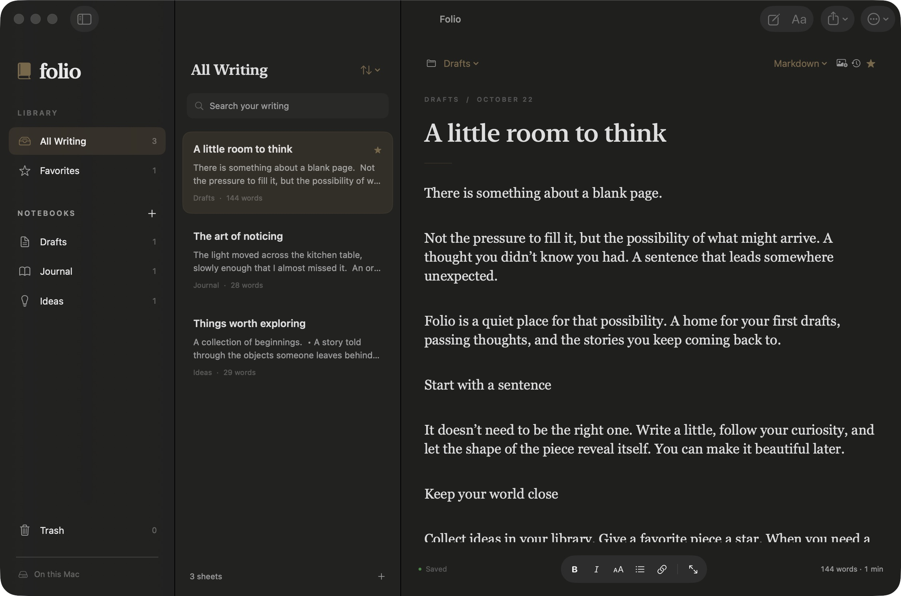

# Folio

A macOS writing app by Maya Abdallah. Version 0.3.

A native, local-first macOS writing app built with SwiftUI and AppKit, with Liquid Glass navigation and controls. Requires macOS 26 or newer; build with Xcode 26 or newer.

## Workspace



The running app with a separate sample library.

## Open and run

Open `Folio.xcodeproj`, select **Folio → My Mac**, and press **Command-R**. The project is configured to sign for local use without a developer account. This repository contains source code. A notarized public download is not currently provided.

## Writing

- Create sheets with Command-N. New sheets use rich text; existing version 1 sheets retain Markdown mode and their original text.
- Rich text supports bold, italic, paragraph headings, bullet lists, links, native spelling, undo/redo, and copy/paste. Use the floating formatting bar or the Format menu.
- Change editor mode using the **Rich Text / Markdown** menu above the page. A version is saved before conversion. Conversion supports basic prose, headings, emphasis, and links; it is not a full CommonMark engine, and complex Markdown tables, nested structures, or HTML are not guaranteed to round-trip.
- Use **Command-F** to find within a sheet; Find and Replace is in the Edit menu. Option-Command-F searches the library.
- Shift-Command-F toggles focus mode. Drag the column dividers to adjust the library layout.
- Click the word count to set a target. The progress indicator measures the current sheet's total words, not daily productivity.

## Visual ideas

The Visual Ideas notebook uses an image-first page: choose a cover image, add a title, and write below it. Add or change a cover with the photo button above any sheet. Images are copied into the library, resized to a maximum 1800 pixels, and included in autosave, duplicate sheets, versions, and library backups. Existing text-only sheets continue to work. Document exports currently include writing only; use a library backup to preserve covers.

## Organizing

Create, rename, and remove notebooks with the plus button next to Notebooks. Drafts is always available. Removing a notebook moves its sheets to Drafts, including trashed sheets; it does not delete writing.

Right-click a sheet to duplicate it, favorite it, move it, or send it to trash. Sheets can also be dragged into notebooks. Sort by modified time, title, or word count using the list's sort menu. Library search matches titles and content in the selected notebook or collection.

Trash keeps sheets until you choose Empty Trash and confirm. Emptying trash first writes a library recovery backup. Import that backup to recover removed sheets as copies if needed.

## Import, export, and print

- **Command-O:** import TXT, Markdown, RTF, and DOCX. Imports create copies in Folio; they do not edit the source files. Partial batch failures are reported while successfully imported documents are retained.
- **Share toolbar menu / File → Export:** export Markdown, plain text, RTF, DOCX, or PDF. Rich text and Word exports preserve basic text formatting. Complex Word layouts, tables, embedded images, tracked changes, and comments are not supported as a full Word editing workflow.
- **Shift-Command-E:** export PDF. PDF export includes the title, paginated text, and page numbers on A4 pages.
- **Command-P:** native print dialog.

## Saving and recovery

Writing saves locally after a 350 ms pause in editing. Command-S saves immediately; closing a window or quitting also saves. Folio reports errors, prevents quitting without acknowledgment after a save failure, and does not silently overwrite a file modified by another process.

The sandboxed library is normally at:

`~/Library/Containers/com.folio.writing/Data/Library/Application Support/Folio/library.json`

Use **Folio → Settings → Show Library Folder** to locate it. Settings are available with Command-comma or from the Aa toolbar button.

- **Automatic library backups:** the preceding valid library is saved at most once every five minutes of changed saves, with up to 20 recent backups retained in `Backups/`. Existing version 1 and 2 libraries are read without changing manuscript content; the first changed save creates a version 3 library and preserves a prior backup.
- **Document versions:** up to 50 versions per sheet, captured before the first edit in a session, then at five-minute intervals while editing, and before conversion, trash, or version restoration. Shift-Command-S creates a version on demand. Open history with the clock icon above the editor.
- **Restore a document version:** restores text, title, and formatting while keeping the current notebook and writing goal; current writing is checkpointed first.
- **Export Library Backup:** exports all sheets, notebooks, and versions to a `.folio` file. Keep this on another disk or in your own backup service for protection from device loss.
- **Import Library Backup:** adds recovered copies and keeps current writing. If the active library cannot be read, its original file is moved aside as `Preserved-<UUID>.json` before recovery.
- **Reload Library:** explicitly discards the in-memory state and reads the file again. Export a library backup first if you have unsaved work or a conflict.

## iCloud

Folio includes optional CloudKit synchronization with offline editing, per-sheet conflict copies, tombstones, and account-change protection. The delivered local app shows **iCloud setup required** because the available Xcode account is a Personal Team. It has not uploaded writing to iCloud. See [iCloud Setup](iCloud%20Setup.md) to activate the **Folio iCloud** scheme with an eligible Apple Developer Program team.

Sync covers writing, formatting, notebooks, favorites, goals, and Trash. It checks every 30 seconds while open and on app activation; Settings also offers Sync Now. Backups and versions remain local. The normal Folio scheme has no network/cloud capability; the cloud scheme enables outgoing network access for CloudKit. There are no analytics.

## Verification

Run `Tests/run.sh`. The suite uses temporary storage and checks migration, Unicode, backups, corrupt-file recovery, concurrent write conflicts, notebooks, trash, versions, autosave, selection, goals, Markdown conversion, native rich formatting and undo, DOCX/RTF round-tripping, and multi-page PDF export. It does not touch the user's library.

```sh
xcodebuild -project Folio.xcodeproj -scheme Folio -configuration Release build
```

The suite checks local writing and recovery alongside sync behavior using simulated Macs and a fake CloudKit transport. Cloud-enabled code can be compiled with signing disabled, but live CloudKit round trips require provisioning and remain unverified. Broad compatibility testing, notarization/App Store distribution, collaboration, and iOS/web clients are outside the current scope.

## Source layout

- `CloudSync.swift`: CloudKit transport, atomic sync metadata, three-way merges, conflict preservation, retries, and account isolation.
- `Library.swift`: versioned document schema, atomic storage, backup files, concurrent-write protection.
- `LibraryStore.swift`: library operations, autosave, versions, recovery, and import/export panels.
- `DocumentIO.swift`: rich text / Markdown conversion, document import, DOCX/RTF/PDF export.
- `Editor.swift`: native NSTextView, formatting, find/replace, selection, and undo.
- `ContentView.swift`: library and editor workspace.
- `LibraryPanels.swift`: notebooks, history, goals, and settings.
- `FolioApp.swift`: app lifecycle, commands, document opening, and printing.
- `Assets.xcassets`: the generated Folio icon; source and prompts are in `Design/`.


## License

[MIT](LICENSE) · Copyright 2026 Maya Abdallah. The app icon was generated with AI; its source and generation notes are included in `Design/`.
